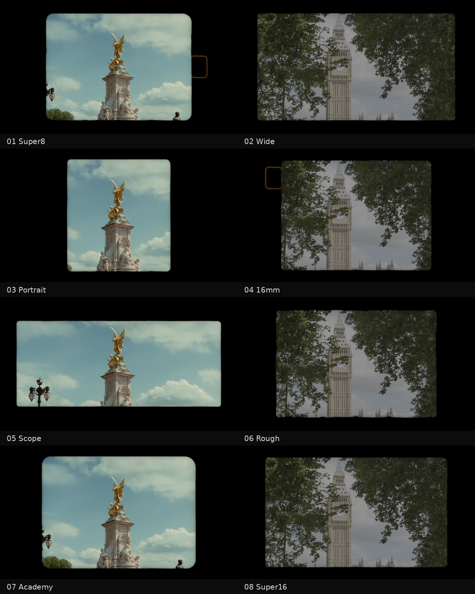

# Gradelux Film Mattes

Eight simple film mattes for DaVinci Resolve. Each one is a pure black surround with the picture in a
slightly rounded frame, an organic, slightly uneven gate edge and a gentle shade just inside the edge.
Two of them also have a dark perforation with a thin amber rim.

| File | Frame |
|---|---|
| `Gradelux_Matte_01_Super8` | Super 8, rounded corners, perforation on the right |
| `Gradelux_Matte_02_Wide` | Wide 1.85, fills most of the screen |
| `Gradelux_Matte_03_Portrait` | Tall, almost square frame |
| `Gradelux_Matte_04_16mm` | 16mm, perforation at the top left |
| `Gradelux_Matte_05_Scope` | Anamorphic 2.39 |
| `Gradelux_Matte_06_Rough` | 35mm 3:2 with a rough, hand-filed edge and small notches |
| `Gradelux_Matte_07_Academy` | Academy 1.37, softer edge, rounder corners |
| `Gradelux_Matte_08_Super16` | Super 16 at 1.66, crisp edge |

## Controls

- **Matte Size:** makes the frame bigger or smaller.
- **Edge Softness:** how sharp the gate edge is.
- **Edge Roughness:** how wavy and notched the edge is. At 0 the edge is clean.
- **Edge Shade:** the slight darkening just inside the edge.
- **Film Motion:** makes the matte move like real film. The frame and picture jitter a few pixels each
  frame (gate weave), the edge shimmers slightly (edge boil) and the exposure flickers very slightly.
  It changes every frame on its own, driven by your footage. On a still image it stays put.
- **Perforation:** on or off (Super 8 and 16mm only).
- **Opacity:** fades the matte. At 0 the picture is untouched.

## Install

1. Copy the `.dctl` files into Resolve's LUT folder (a subfolder such as `LUT/Gradelux Mattes/` is fine):
   - macOS: `/Library/Application Support/Blackmagic Design/DaVinci Resolve/LUT/`
   - Windows: `C:\ProgramData\Blackmagic Design\DaVinci Resolve\Support\LUT\`
2. Restart Resolve.
3. On the Color page, add a node at the end of your grade, drag the **DCTL** effect onto it and pick a matte.

Put the matte on the last node, after your output conversion to Rec.709, and after any grain or
halation. The picture is scaled to fill the frame, so use Matte Size to frame your shot.

## Rebuilding and testing

The files are generated by `tools/filmborders/build.py` and tested with `tools/filmborders/test.py`. The
tests cover Resolve text rules, an OpenCL compile with controls as text macros, exact pass-through at
Opacity 0, extreme input and odd resolutions.
