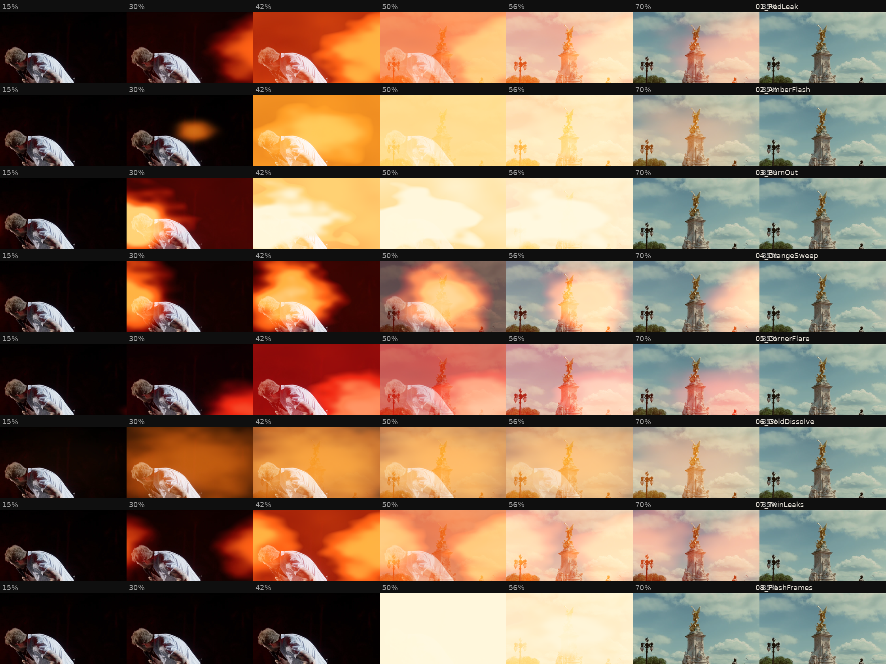

# Gradelux Film Transitions

Eight light-leak and film-burn transitions for DaVinci Resolve. A leak of light builds over the outgoing
clip (deep red when faint, then orange, amber and, at its hottest, cream white), the cut to the incoming
clip happens hidden under the brightest moment, and the leak fades off the new clip.

*Each row runs from 15% to 85% through the transition.*

| File | Look |
|---|---|
| `Gradelux_Transition_01_RedLeak` | Deep red glow from the right, blooms into an amber flood |
| `Gradelux_Transition_02_AmberFlash` | Quick golden flash from the centre |
| `Gradelux_Transition_03_BurnOut` | Red-orange flare from the left that burns out to cream white |
| `Gradelux_Transition_04_OrangeSweep` | Soft orange leak travelling left to right |
| `Gradelux_Transition_05_CornerFlare` | Hot red flare from the bottom right corner |
| `Gradelux_Transition_06_GoldDissolve` | Gentle golden glow with a soft dissolve |
| `Gradelux_Transition_07_TwinLeaks` | Warm leaks from both sides meeting in the middle |
| `Gradelux_Transition_08_FlashFrames` | Two quick flash frames, then a full burn |

## Install and use

1. Copy the `.dctl` files into Resolve's LUT folder (a subfolder such as `LUT/Gradelux Transitions/` is fine):
   - macOS: `/Library/Application Support/Blackmagic Design/DaVinci Resolve/LUT/`
   - Windows: `C:\ProgramData\Blackmagic Design\DaVinci Resolve\Support\LUT\`
2. Restart Resolve.
3. On the Edit page, open **Effects > OpenFX > Transitions > ResolveFX Color > DCTL** and drag it onto
   the cut between two clips.
4. In the Inspector, pick a Gradelux transition from the **DCTL List**.
5. Set the length on the timeline. About 12 to 24 frames feels like the reference; longer gives a
   slower, dreamier leak.

The transitions have no sliders. Each file is one finished look, and its timing follows the transition
length on the timeline. They look richest on darker footage, like real light leaks.

## Rebuilding and testing

The files are generated by `tools/filmtransitions/build.py` and tested with
`tools/filmtransitions/test.py`. The tests cover the text rules Resolve needs, an OpenCL compile, exact
outgoing clip at 0%, exact incoming clip at 100%, and no NaN or infinity on extreme input.
