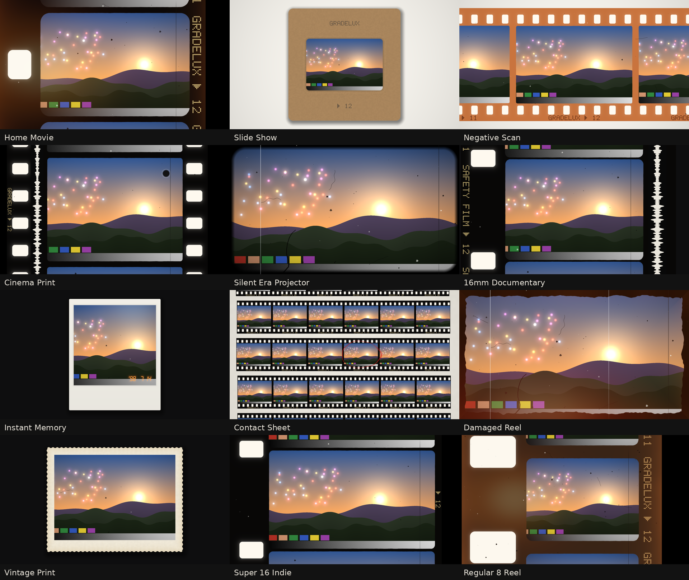
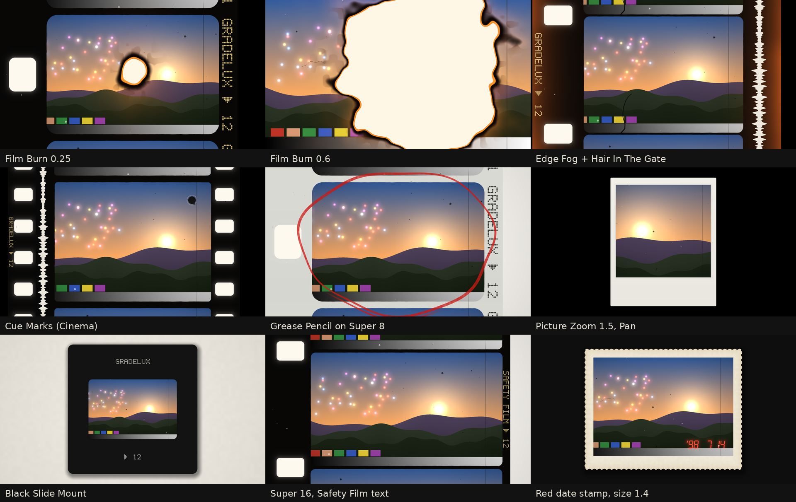

# Gradelux FrameLab

Film borders, film strips and film damage for DaVinci Resolve.

- **`Gradelux_FrameLab_v2.dctl`** (current): 12 one-click presets, 13 frame styles, film burn,
  edge fog, cue marks, hair in the gate, grease pencil, picture zoom and pan.
- `Gradelux_FrameLab_v1.dctl`: the first version, kept so existing grades still open.

*These previews were rendered on a computer by compiling the DCTL's own code as C, on a
synthetic test scene. They have not yet been checked inside Resolve (see "Not yet tested").*

## Quick start

1. Install the DCTL (below) and add it to the **last node** of your grade.
2. Pick a **Preset**. That's a finished look.
3. Adjust **Frame Size**, **Film Roll**, **Rotation** and **Picture Zoom / Pan** to frame your shot.
   These always work, even with a preset on.
4. To build your own look, set Preset to **Custom (Use Sliders)** and use the sliders.

## Presets

| Preset | What it is |
|---|---|
| Home Movie | Super 8 with weave, flicker, dust, a warm light leak and edge fog |
| Slide Show | Cardboard slide mount on a light table |
| Negative Scan | Orange 35mm negative strip on a light table |
| Cinema Print | 35mm print with soundtrack, scratches and reel-change cue marks |
| Silent Era Projector | Soft projector gate, heavy flicker, weave, scratches and a hair in the gate |
| 16mm Documentary | 16mm with soundtrack and "SAFETY FILM" edge print |
| Instant Memory | Instant photo with a golden leak and a date stamp |
| Contact Sheet | Rows of 35mm strips on paper with a red grease-pencil mark |
| Damaged Reel | Rough filed border, heavy dust and scratches, red leak, edge fog |
| Vintage Print | Scalloped-edge paper print |
| Super 16 Indie | Wide Super 16 frame with frame numbers |
| Regular 8 Reel | Aged brown Regular 8 with big perforations, leaks and fog |

While a preset is active it sets the frame, film and damage controls. These always stay
yours: Frame Size, Film Roll, Rotation, Picture Zoom / Pan, Film Burn, Burn Position, date
values, Countdown Leader and the animation controls. Instant Memory also turns on the date stamp.

## Frame styles

| Style | What you get |
|---|---|
| None | No frame. Damage and light effects still work full screen |
| Super 8 | Rounded frame, small perforation beside the frame, edge print |
| Regular 8 | Big perforations at the frame line, wider film |
| 16mm | Single-perf 16mm with an optical soundtrack |
| Super 16 | Wider 1.66 frame that uses the soundtrack area |
| 35mm Motion Picture | Four perfs per frame both sides, soundtrack, tiny edge print |
| 35mm Still Strip | Horizontal 35mm strip, 8 perfs per frame, frame numbers |
| Contact Sheet | Rows of six-frame 35mm strips on paper |
| 120 Medium Format | Square frames on a wide strip |
| Instant Print | Instant-photo card with a thick bottom border |
| Vintage Print | White print with a scalloped (deckle) edge |
| Slide Mount | 35mm slide in a mount. Film Base sets the mount: Black Reversal = black plastic, Orange Negative = tan cardboard, Clear = white plastic, Aged Brown = old cardboard |
| Filed Gate | Full-screen footage with a rough black border |
| Projector Gate | Soft rounded projector gate with a bright centre |

## Controls

**Frame**
- **Film Base:** Black Reversal, Orange Negative, Clear or Aged Brown film edges.
- **Background:** Black, Charcoal, Light Table or White Paper.
- **Frame Size / Film Roll / Rotation:** zoom, slide the film along by frames, tilt. Keyframe
  Film Roll to run the film through the frame.
- **Picture Zoom / Pan X / Pan Y:** crop in on your shot inside the frame.
- **Corner Roundness, Gate Softness, Edge Roughness:** shape of the picture edge.
  Edge Roughness also roughens the filed gate.
- **Edge Markings / Edge Text / Soundtrack:** edge print on or off; GRADELUX, SAFETY FILM or
  frame numbers only; optical soundtrack on or off.

**Damage:** Dust (specks and hairs), Scratches, Hair In The Gate, Gate Weave (each frame on a
strip jitters on its own), Flicker, Vignette.

**Light**
- **Light Leak:** colour, position (0 = left, 0.5 = top, ±1 = right, −0.5 = bottom) and size.
- **Edge Fog:** warm fogging that creeps in from the film edges.
- **Film Burn / Burn Position:** the film melts in the gate. Keyframe Film Burn from 0 to 1 over
  about a second for a burn-out transition.

**Marks:** Cue Marks (reel-change dots, top right) and Grease Pencil Mark (red loop around the
centre frame on strips and contact sheets).

**Date stamp:** on/off, format, year, month, day, size, and orange, red or yellow.

**Countdown leader:** 8 → 2 countdown. Needs the Time slider (see Animation).

## Install

1. Copy `Gradelux_FrameLab_v2.dctl` into Resolve's LUT folder:
   - **macOS:** `/Library/Application Support/Blackmagic Design/DaVinci Resolve/LUT/`
   - **Windows:** `C:\ProgramData\Blackmagic Design\DaVinci Resolve\Support\LUT\`
   - **Linux:** `/opt/resolve/LUT/`
2. Restart Resolve, or go to Project Settings → Color Management → Lookup Tables → Update Lists.
3. On the Color page, add a node, open Effects, drag **DCTL** onto the node and pick
   `Gradelux_FrameLab_v2`.

## Where to put it

Put FrameLab on the **last node**, after everything else:

`Camera Log → CST to DaVinci Wide Gamut / Intermediate → grading → CST to Rec.709 Gamma 2.4 →
ColorLab → (PrintLab, Halation, GrainLab) → FrameLab`

- Its colours (film base, perforation light, date stamp) are designed for Rec.709 Gamma 2.4.
- If Resolve Color Management converts to Rec.709 only at the output, add your own CST to
  Rec.709 node and put FrameLab after it.
- Grain and halation belong inside the picture, so run them before FrameLab.
- FrameLab moves and crops the picture, so it cannot be exported as a LUT.

## Animation

A DCTL has no frame counter. Animation Source picks how FrameLab gets per-frame randomness:

- **Auto From Footage (default):** reads 6 pixels of each frame and turns them into a random seed.
  Camera footage changes slightly every frame, so dust, weave, flicker and scratches change
  every frame with no setup. On a still image they freeze.
- **Time Slider:** keyframe **Time** (0 on the first frame, the frame count on the last, linear).
  Use it for still images, the countdown leader and slowly drifting leaks and fog.

**Variation** changes the random pattern, so neighbouring clips don't get identical dust.

## Speed

FrameLab draws everything with math from the pixel's own position. It never blurs, so its
cost stays the same at any setting. Each pixel reads at most 4 footage pixels, plus 6 for
the animation seed. When no damage effect is on, it skips the seed reads entirely.

## Fixes

- **Build error "main DCTL function's return value must be float3"** (first Resolve tests, v2).
  Resolve shows this message when the code fails to compile on the GPU. The cause was a
  variable named `half`. That is a built-in type name in Apple Metal and OpenCL, so the
  code compiled on a computer but not in Resolve. It is renamed in v1 and v2. Footage reads
  also now happen only inside the main function. Output is bit-identical to before
  (200 random settings checked for each version).
- The tests now also compile the DCTL as **OpenCL** with clang
  (`tests/framelab/build_cl.py`). This catches GPU-only problems like reserved words and
  doubles.

## Not yet tested in Resolve

These were checked on a computer only. They still need checking in DaVinci Resolve Studio:

1. **Compiling** on your GPU back end (Metal on Mac, CUDA or OpenCL on Windows/Linux).
2. **Text direction.** FrameLab expects pixel row 0 at the top. If the edge print and date stamp
   look upside down or mirrored, change `#define GLX_Y_DOWN 1` to `0` near the top of the file.
3. **Keyframing** Time, Film Roll and Film Burn, and the Auto From Footage seed with the render
   cache.
4. **Playback speed** at 4K with Dust and Scratches high.
5. **Look on real footage.** All previews so far use a synthetic scene.

## Tests

`python3 tests/framelab/run_tests.py --preview docs/FrameLab_v2_presets.png` compiles the DCTL as
C and checks it (add `--dctl Gradelux_FrameLab_v1.dctl` to test v1). Both versions pass:

| Test | Result |
|---|---|
| Frame Style None, Preset Custom, all effects off: output equals input bit-for-bit, including negative and above-1 values | Passed |
| 150 random settings on extreme input (−50, 5000, 1e-8, random): no NaN or infinity, no reads outside the image | Passed |
| Every style with every effect at maximum | Passed |
| Resolutions 17×9, 64×36, 1080×1920, 2400×600, 3840×2160 | Passed |
| Same frame and settings give identical output | Passed |
