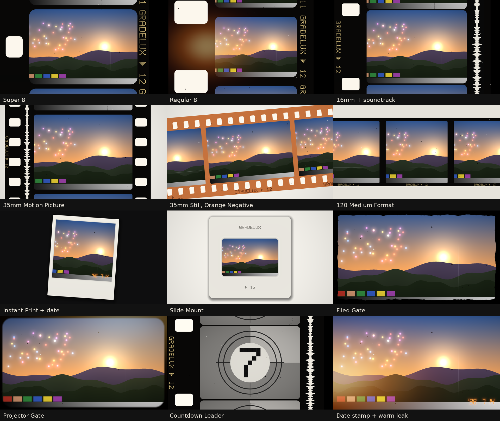

# Gradelux FrameLab v1

Film frame overlays and film damage for DaVinci Resolve, in one DCTL:
`Gradelux_FrameLab_v1.dctl`.

*The preview was rendered on a computer by compiling the DCTL's own code as C, using a
synthetic test scene. It has not yet been checked inside Resolve (see "Not yet tested" below).*

## What's in it

**Frame styles** (Frame Style dropdown)

| Style | What you get |
|---|---|
| None | No frame. The damage and light effects still work on full-screen footage |
| Super 8 | Rounded frame, one small perforation per frame centred on the frame, edge print |
| Regular 8 | Larger perforations at the frame line, wider film |
| 16mm | Single-perf 16mm with an optical soundtrack down the side |
| 35mm Motion Picture | Four perfs per frame on both sides, soundtrack, tiny edge print |
| 35mm Still Strip | Horizontal 35mm negative strip, 8 perfs per frame, frame numbers |
| 120 Medium Format | Square frames on a wide strip, no perforations |
| Instant Print | Instant-photo card with a thick bottom border and a drop shadow |
| Slide Mount | 35mm slide in a mount, with printed text |
| Filed Gate | Full-screen footage with a rough, hand-filed black border |
| Projector Gate | Soft rounded projector gate with a bright centre |

**Film look of the strip**
- **Film Base:** Black Reversal (Super 8 / Kodachrome style edges), Orange Negative, Clear, Aged Brown.
- **Background:** Black, Charcoal, Light Table, White Paper.
- **Frame Size, Film Roll, Rotation:** zoom the strip, slide it along by whole or partial frames,
  and tilt it. Keyframe Film Roll to make the film run through the frame.
- **Corner Roundness, Gate Softness, Border Roughness:** shape of the picture window and of the
  filed gate edge.
- **Edge Markings / Soundtrack:** turn the edge print and optical soundtrack on or off.

**Film damage and light**
- **Dust:** specks (mostly dark, some white) and curly hairs.
- **Scratches:** thin lines running along the film, bright or dark, broken along their length.
- **Gate Weave:** the picture jitters and drifts slightly.
- **Flicker:** brightness pulses from frame to frame.
- **Vignette:** darkens the picture corners.
- **Light Leak:** an orange, golden, deep red or prism glow from the edge. Leak Position moves it
  around the frame: 0 = left, 0.5 = top, ±1 = right, −0.5 = bottom.

**Extras**
- **Date Stamp:** orange seven-segment date burned into the picture, with Year, Month, Day,
  format and size.
- **Countdown Leader:** classic 8 → 2 countdown. It needs the Time slider (see Animation).

## Install

1. Copy `Gradelux_FrameLab_v1.dctl` into Resolve's LUT folder:
   - **macOS:** `/Library/Application Support/Blackmagic Design/DaVinci Resolve/LUT/`
   - **Windows:** `C:\ProgramData\Blackmagic Design\DaVinci Resolve\Support\LUT\`
   - **Linux:** `/opt/resolve/LUT/`

   A subfolder such as `LUT/Gradelux/` is fine.
2. Restart Resolve, or go to Project Settings → Color Management → Lookup Tables → Update Lists.
3. On the Color page, add a node, open Effects, drag **DCTL** onto the node and choose
   `Gradelux_FrameLab_v1` from the DCTL List.

## Where to put it

Put FrameLab on the **last node** of your grade, after everything else:

`Camera Log → CST to DaVinci Wide Gamut / Intermediate → grading → CST to Rec.709 Gamma 2.4 →
ColorLab → (PrintLab, Halation, GrainLab) → FrameLab`

- FrameLab's colours (film base, perforation light, date stamp) are designed for Rec.709 Gamma 2.4,
  so it belongs after your output conversion.
- If Resolve Color Management converts to Rec.709 for you at the output, there is no Rec.709 node
  to sit after. In that case, put FrameLab on a Timeline node (Color page → node editor → Timeline)
  only if your timeline space is Rec.709. Otherwise add your own CST to Rec.709 node and put
  FrameLab after it.
- Grain from GrainLab belongs *inside* the picture, so run it before FrameLab.
- FrameLab moves and crops the picture, so it **cannot be exported as a LUT**.

## Animation

A DCTL has no frame counter. FrameLab gets its per-frame randomness one of two ways:

- **Auto From Footage (default):** reads 12 pixels of each frame and turns them into a random seed.
  Real camera footage changes slightly every frame, so dust, weave, flicker and scratches change
  every frame with no setup. On a still image or perfectly static graphics they freeze.
- **Time Slider:** keyframe **Time** on the Color page, for example 0 on the first frame of the clip
  and the clip's frame count on the last frame, with linear interpolation. Use this for still
  images, for the countdown leader, and for slowly drifting light leaks.

**Variation** changes the random pattern, so two clips next to each other don't get identical dust.

**Countdown leader:** turn on Countdown Leader, set Leader Frame Rate to your timeline frame rate,
and keyframe Time from 0 upward. It counts 8, 7, ... 2, one number per second, then shows your
footage.

## Tips

- Classic Super 8 scan: Super 8, Black Reversal, Black background, Dust 0.25, Gate Weave 0.3,
  Flicker 0.2 (these are the defaults).
- Negative on a light table: 35mm Still Strip, Orange Negative, Light Table, Rotation −5.
- Home-movie memory: Super 8, Date Stamp on, Light Leak 0.5 at position 0.1.
- Full-screen damage only: Frame Style None, then raise Dust, Scratches and Flicker.

## Not yet tested in Resolve

These were checked on a computer only. They still need checking in DaVinci Resolve Studio:

1. **Compiling** on your GPU back end (Metal on Mac, CUDA or OpenCL on Windows/Linux).
2. **Text direction.** FrameLab expects pixel row 0 at the top of the frame. If the edge print and
   date stamp appear upside down or mirrored, change `#define GLX_Y_DOWN 1` to `0` near the top
   of the file.
3. **Keyframing Time** and the Auto From Footage seed on real footage, including how they behave
   with Resolve's render cache.
4. **Speed** at 4K with Dust and Scratches high.
5. **Look on real footage.** All previews so far use a synthetic test scene.

## Tests

`python3 tests/framelab/run_tests.py --preview docs/FrameLab_v1_preview.png` compiles the DCTL as
C and checks:

| Test | Result |
|---|---|
| Frame Style None with all effects off returns the input bit-for-bit, including negative and above-1 values | Passed |
| 150 random settings on extreme input (−50, 5000, 1e-8, random) produce no NaN or infinity and never read outside the image | Passed |
| Every style with every effect at maximum | Passed |
| Resolutions 17×9, 64×36, 1080×1920, 2400×600, 3840×2160 | Passed |
| Same frame and settings give identical output | Passed |
